# Function Dependencies — Contract / Ledger / Invoice flow

Call graph for the functions catalogued in `05_FUNCTION_CATALOG.md` (F1-F6). Verified against
code; "UNKNOWN" edges are explicitly marked as such rather than guessed.

```mermaid
flowchart TD
  subgraph Frontend[sukhWeb]
    UI[Contract create/edit UI] -->|gereeUusgekh| F6[useGereeCRUD / useGereeJagsaalt\nsrc/lib/useGeree.tsx]
    UnknownCaller[UNKNOWN caller\n- grep 'uldegdelBodyo' in sukhWeb] -.->|POST /uldegdelBodyo| F3
  end

  subgraph Backend[sukhBackv2]
    F6 -->|POST /geree| F1[createGeree\ncontroller/gereeController.js]
    F1 --> ZS[zardalAngilal.zardluudShuuye]
    F1 --> F2[createInvoiceForContract\nservices/invoiceService.js]
    F2 --> GereeRaw[(geree collection\nraw .collection.findOne)]
    F2 --> GuilgeeW[(guilgeeAvlaguud\nwrite)]
    F2 --> NekhW1[(nekhemjlekhiinTuukh\nwrite)]

    F3[uldegdelBodyo\ncontroller/gereeController.js] --> GuilgeeR1[(guilgeeAvlaguud\nquery: date-bounded)]
    F3 --> GuilgeeR2[(guilgeeAvlaguud\nsummaryQuery: upper-bounded only)]
    F3 --> F4[khungulultNekhemjlekhendOnooyo\nservices/guilgeeService.js]
    F3 --> NekhW2[(nekhemjlekhiinTuukh\nupdateOne tuluv/uldegdel)]
    F4 --> NekhR1[(nekhemjlekhiinTuukh\nread, for date matching)]

    PayFlow[controller/tulbur.js\npayment recorded] --> F5[syncInvoicesStatus\nservices/guilgeeService.js]
    LedgerWrite[guilgeeService ledger-write helpers\nlines 74, 150, 368] --> F5
    F5 --> NekhW3[(nekhemjlekhiinTuukh\nwrite, canonical)]
    F5 --> GuilgeeR3[(guilgeeAvlaguud\nread, canonical)]
  end

  F3 -.->|"duplicates the same rule as\n(code comment: 'ижил дүрэм')"| F5

  style F3 fill:#5a2d2d,stroke:#d9534f
  style F5 fill:#2d4a2d,stroke:#5cb85c
  classDef unknown stroke-dasharray: 5 5
  class UnknownCaller unknown
```

## Reading the diagram

- **Green (F5, `syncInvoicesStatus`)** is the canonical, idempotent invoice-status-sync
  function — the one to call when writing new ledger-affecting code.
- **Red (F3, `uldegdelBodyo`)** independently reimplements the same FIFO/discount-matching
  rule to serve the contract-balance read endpoint. It is **not** wired to F5. A change to the
  allocation rule in F5 will not automatically apply to F3's output, and vice versa.
- The dashed "UNKNOWN caller" node is intentional: `/uldegdelBodyo` is clearly a live route
  (defined, wired, non-trivial), but no frontend call site was found in `sukhWeb/src/lib/`
  during this pass. Before changing F3's contract or removing it, grep the whole `sukhWeb` repo
  (not just `src/lib/`) for `uldegdelBodyo` — it may be called from a component directly via
  `uilchilgee()` rather than through a dedicated hook.

## Data shared across functions (not just calls)

- `guilgeeAvlaguud` (the ledger line-item collection) is read/written by F2, F3, F4, and F5 —
  it is the true source of truth for balances; `nekhemjlekhiinTuukh.tuluv`/`uldegdel` are
  **derived, cached** fields written by whichever of F3/F5 last ran for that contract. If F3
  and F5 ever disagree (plausible, since they're separate implementations of the same rule),
  the displayed invoice status will depend on which function wrote last — a race/consistency
  risk, not just a style issue. See `17_GAPS_AND_RISKS.md` R2.
- `baiguullaga.tokhirgoo.*` (org-level config flags: `guidelBuchiltKhonogEsekh`,
  `sekhDemjikhTulburAvakhEsekh`) gates which cost-calculation branch runs in
  `zaaltOlnoorOruulya` (meter-reading bulk import, `gereeController.js:42-161`, not in the F1-F6
  catalog above — a sibling function in the same controller, touched while reading this file).
  That function also contains a hardcoded organization ID
  (`req.body.baiguullagiinId === "679aea9032299b7ba8462a77"`, line 91) selecting between two
  magic constants (11520 / 15500) in the capacity-fee formula — flagged in
  `17_GAPS_AND_RISKS.md` R3.
